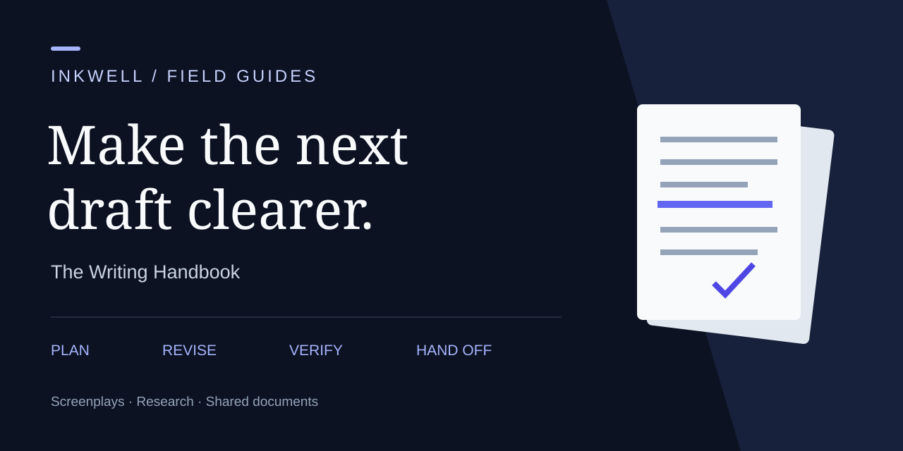

# Inkwell Writing Handbook



**Plan a draft, review a revision, and prepare a clean handoff.** Practical workflows and reusable templates for screenwriters, novelists, researchers, and teams working on structured documents.

Maintained by [Inkwell](https://github.com/inkwell-app). The templates work in any editor; the resource directory connects each job to Inkwell’s products, free tools, guides, and research.

## Start with something useful

| Your next task | Start here | Take away |
|---|---|---|
| Turn an idea into a draft | [Plan a draft](workflows/plan-a-draft.md) | A brief and a scene or section outline |
| Work through feedback | [Review a revision](workflows/review-a-revision.md) | A prioritized revision log and a decision record |
| Review an AI editing suggestion | [Review AI edits](workflows/review-ai-edits.md) | A checklist that preserves intent and checks evidence |
| Send work to another person or tool | [Prepare a handoff](workflows/prepare-a-handoff.md) | A manifest and a round-trip checklist |

## Copy a template

Start with the [template selection and adaptation guide](docs/choose-a-template.md). Pick one useful artifact for your next task; a short solo pass does not need every table.

Download the repository as a ZIP using **Code → Download ZIP**, or clone it:

```sh
git clone https://github.com/inkwell-app/writing-handbook.git
cd writing-handbook
```

No installation or Inkwell account is required to use these Markdown templates.

- [Project brief](templates/project-brief.md) — audience, purpose, constraints and a definition of done.
- [Scene or section outline](templates/outline.md) — what changes in each unit of the draft.
- [Revision log](templates/revision-log.md) — turn feedback into decisions you can verify.
- [Continuity ledger](templates/continuity-ledger.md) — track story facts, claims and dependencies.
- [Feedback session](templates/feedback-session.md) — run a table read, workshop or document review.
- [Handoff manifest](templates/handoff-manifest.md) — name the files, versions and known limitations.
- [Research evidence ledger](templates/evidence-ledger.md) — connect claims to sources and uncertainty.

Practice with [The Last Light](examples/the-last-light.md), a screenplay revision with before-and-after passages, or [a library workshop decision](examples/library-workshop.md), a structured document with evidence limits and conflicting feedback.

## Find the right Inkwell resource

<!-- resources:start -->

**Jump to:** [Use a free writing tool](#use-a-free-writing-tool) · [Start from a template](#start-from-a-template) · [Learn the craft](#learn-the-craft) · [Run an AI pass](#run-an-ai-pass) · [Look up a term](#look-up-a-term) · [Switch from another app](#switch-from-another-app) · [Learn and explore](#learn-and-explore) · [Find your workflow](#find-your-workflow) · [Write with Inkwell](#write-with-inkwell) · [Get help and follow the product](#get-help-and-follow-the-product) · [Read in your language](#read-in-your-language)

### Use a free writing tool

Free tools, grouped by the job in front of you.

| Job | Tools |
|---|---|
| **Check a file** | [FDX Inspector](https://www.inkwell.software/tools/fdx-inspector?utm_source=github&utm_medium=referral&utm_campaign=writing_handbook&utm_id=github_writing_handbook&utm_source_platform=github&utm_content=directory_fdx_inspector "Inspect a Final Draft file before a handoff") · [Fountain validator](https://www.inkwell.software/tools/fountain-validator?utm_source=github&utm_medium=referral&utm_campaign=writing_handbook&utm_id=github_writing_handbook&utm_source_platform=github&utm_content=directory_fountain_validator "Check screenplay structure") · [Screenplay converter](https://www.inkwell.software/tools/screenplay-converter?utm_source=github&utm_medium=referral&utm_campaign=writing_handbook&utm_id=github_writing_handbook&utm_source_platform=github&utm_content=directory_screenplay_converter "View an FDX file, export it to PDF, or turn a PDF into Fountain") · [Screenplay length checker](https://www.inkwell.software/tools/screenplay-length?utm_source=github&utm_medium=referral&utm_campaign=writing_handbook&utm_id=github_writing_handbook&utm_source_platform=github&utm_content=directory_screenplay_length "Estimate page count and running time") · [Markdown to Word](https://www.inkwell.software/tools/markdown-to-word?utm_source=github&utm_medium=referral&utm_campaign=writing_handbook&utm_id=github_writing_handbook&utm_source_platform=github&utm_content=directory_markdown_to_word "Convert Markdown to a Word document") |
| **Read a draft** | [Screenplay Diff](https://www.inkwell.software/tools/screenplay-diff?utm_source=github&utm_medium=referral&utm_campaign=writing_handbook&utm_id=github_writing_handbook&utm_source_platform=github&utm_content=directory_screenplay_diff "Compare two drafts") · [Screenplay analyzer](https://www.inkwell.software/tools/screenplay-analyzer?utm_source=github&utm_medium=referral&utm_campaign=writing_handbook&utm_id=github_writing_handbook&utm_source_platform=github&utm_content=directory_screenplay_analyzer "Count scenes, characters and dialogue in a draft") · [Dialogue balance](https://www.inkwell.software/tools/dialogue-balance?utm_source=github&utm_medium=referral&utm_campaign=writing_handbook&utm_id=github_writing_handbook&utm_source_platform=github&utm_content=directory_dialogue_balance "Explore who speaks") · [Pacing map](https://www.inkwell.software/tools/pacing-map?utm_source=github&utm_medium=referral&utm_campaign=writing_handbook&utm_id=github_writing_handbook&utm_source_platform=github&utm_content=directory_pacing_map "See where scenes run long or short") · [Outline extractor](https://www.inkwell.software/tools/screenplay-outline-extractor?utm_source=github&utm_medium=referral&utm_campaign=writing_handbook&utm_id=github_writing_handbook&utm_source_platform=github&utm_content=directory_outline_extractor "Pull a scene outline out of a Fountain draft") |
| **Plan the story** | [Beat sheet calculator](https://www.inkwell.software/tools/beat-sheet-calculator?utm_source=github&utm_medium=referral&utm_campaign=writing_handbook&utm_id=github_writing_handbook&utm_source_platform=github&utm_content=directory_beat_sheet_calculator "Place story beats for your page count") · [Character profile builder](https://www.inkwell.software/tools/character-profile?utm_source=github&utm_medium=referral&utm_campaign=writing_handbook&utm_id=github_writing_handbook&utm_source_platform=github&utm_content=directory_character_profile_tool "Build a character profile scene by scene") · [Period character names](https://www.inkwell.software/tools/character-names?utm_source=github&utm_medium=referral&utm_campaign=writing_handbook&utm_id=github_writing_handbook&utm_source_platform=github&utm_content=directory_character_names "Find names that fit a decade and place") · [Writing goal planner](https://www.inkwell.software/tools/writing-goal-planner?utm_source=github&utm_medium=referral&utm_campaign=writing_handbook&utm_id=github_writing_handbook&utm_source_platform=github&utm_content=directory_writing_goal_planner "Turn a deadline into a daily word goal") |
| **Prepare to shoot or submit** | [Script breakdown](https://www.inkwell.software/tools/script-breakdown?utm_source=github&utm_medium=referral&utm_campaign=writing_handbook&utm_id=github_writing_handbook&utm_source_platform=github&utm_content=directory_script_breakdown "Prepare a scene inventory") · [Table read planner](https://www.inkwell.software/tools/table-read-planner?utm_source=github&utm_medium=referral&utm_campaign=writing_handbook&utm_id=github_writing_handbook&utm_source_platform=github&utm_content=directory_table_read_planner "Time a table read and plan the cast") · [Rehearsal sides builder](https://www.inkwell.software/tools/rehearsal-sides-builder?utm_source=github&utm_medium=referral&utm_campaign=writing_handbook&utm_id=github_writing_handbook&utm_source_platform=github&utm_content=directory_rehearsal_sides "Pull one actor’s scenes into rehearsal sides") · [Title page builder](https://www.inkwell.software/tools/screenplay-title-page-builder?utm_source=github&utm_medium=referral&utm_campaign=writing_handbook&utm_id=github_writing_handbook&utm_source_platform=github&utm_content=directory_title_page_builder "Format a screenplay title page") · [WGA minimums](https://www.inkwell.software/tools/wga-minimums?utm_source=github&utm_medium=referral&utm_campaign=writing_handbook&utm_id=github_writing_handbook&utm_source_platform=github&utm_content=directory_wga_minimums "Look up current minimum pay for screenwriters") · [Representation planner](https://www.inkwell.software/tools/representation-planner?utm_source=github&utm_medium=referral&utm_campaign=writing_handbook&utm_id=github_writing_handbook&utm_source_platform=github&utm_content=directory_representation_planner "Plan a search for an agent or manager") |
| **Everything else** | [All tools](https://www.inkwell.software/tools?utm_source=github&utm_medium=referral&utm_campaign=writing_handbook&utm_id=github_writing_handbook&utm_source_platform=github&utm_content=directory_tools "Browse the complete tool catalog") |

### Start from a template

Starting points on the Inkwell site, grouped by form.

| Form | Templates |
|---|---|
| **Feature** | [Beat sheet template](https://www.inkwell.software/templates/beat-sheet-canvas?utm_source=github&utm_medium=referral&utm_campaign=writing_handbook&utm_id=github_writing_handbook&utm_source_platform=github&utm_content=directory_tpl_beat_sheet "Plan a feature’s turning points") · [Act II outline](https://www.inkwell.software/templates/act-two-outline?utm_source=github&utm_medium=referral&utm_campaign=writing_handbook&utm_id=github_writing_handbook&utm_source_platform=github&utm_content=directory_tpl_act_two "Outline the middle of a feature") · [Screenplay rewrite plan](https://www.inkwell.software/templates/screenplay-rewrite-plan?utm_source=github&utm_medium=referral&utm_campaign=writing_handbook&utm_id=github_writing_handbook&utm_source_platform=github&utm_content=directory_tpl_rewrite_plan "Turn notes into a rewrite plan") |
| **Television** | [TV pilot template](https://www.inkwell.software/templates/pilot-fountain?utm_source=github&utm_medium=referral&utm_campaign=writing_handbook&utm_id=github_writing_handbook&utm_source_platform=github&utm_content=directory_tpl_pilot "Start a pilot episode") · [TV series bible](https://www.inkwell.software/templates/tv-series-bible?utm_source=github&utm_medium=referral&utm_campaign=writing_handbook&utm_id=github_writing_handbook&utm_source_platform=github&utm_content=directory_tpl_series_bible "Lay out a show’s world, characters and seasons") |
| **Short film** | [Short film template](https://www.inkwell.software/templates/short-fountain?utm_source=github&utm_medium=referral&utm_campaign=writing_handbook&utm_id=github_writing_handbook&utm_source_platform=github&utm_content=directory_tpl_short "Start a short film script") |
| **Notes and coverage** | [Script coverage template](https://www.inkwell.software/templates/script-coverage?utm_source=github&utm_medium=referral&utm_campaign=writing_handbook&utm_id=github_writing_handbook&utm_source_platform=github&utm_content=directory_tpl_coverage "Write coverage on a script") · [Table read notes](https://www.inkwell.software/templates/writers-room-read?utm_source=github&utm_medium=referral&utm_campaign=writing_handbook&utm_id=github_writing_handbook&utm_source_platform=github&utm_content=directory_tpl_table_read "Capture notes from a read-through") |
| **Any script** | [Screenplay template for Google Docs and Word](https://www.inkwell.software/templates/screenplay-google-docs-word?utm_source=github&utm_medium=referral&utm_campaign=writing_handbook&utm_id=github_writing_handbook&utm_source_platform=github&utm_content=directory_tpl_google_docs "Format a script in a word processor") |
| **Novel** | [Novel outline](https://www.inkwell.software/templates/novel-outline?utm_source=github&utm_medium=referral&utm_campaign=writing_handbook&utm_id=github_writing_handbook&utm_source_platform=github&utm_content=directory_tpl_novel_outline "Outline a novel chapter by chapter") |

### Learn the craft

Guides from a first idea to a finished, formatted draft.

| Resource | Use it for |
|---|---|
| [How to write a screenplay](https://www.inkwell.software/learn/how-to-write-a-screenplay?utm_source=github&utm_medium=referral&utm_campaign=writing_handbook&utm_id=github_writing_handbook&utm_source_platform=github&utm_content=directory_learn_screenplay) | Go from idea to finished draft |
| [How to become a TV writer](https://www.inkwell.software/learn/how-to-become-a-tv-writer?utm_source=github&utm_medium=referral&utm_campaign=writing_handbook&utm_id=github_writing_handbook&utm_source_platform=github&utm_content=directory_learn_tv_writer) | Understand the path into a writers’ room |
| [How to write a play](https://www.inkwell.software/learn/how-to-write-a-play?utm_source=github&utm_medium=referral&utm_campaign=writing_handbook&utm_id=github_writing_handbook&utm_source_platform=github&utm_content=directory_learn_play) | Write for the stage |
| [How to write a short story](https://www.inkwell.software/learn/how-to-write-a-short-story?utm_source=github&utm_medium=referral&utm_campaign=writing_handbook&utm_id=github_writing_handbook&utm_source_platform=github&utm_content=directory_learn_short_story) | Shape a complete short story |
| [Screenplay formatting](https://www.inkwell.software/resources/screenplay-formatting?utm_source=github&utm_medium=referral&utm_campaign=writing_handbook&utm_id=github_writing_handbook&utm_source_platform=github&utm_content=directory_formatting) | Format montages, intercuts, texts and more |
| [How to break down a screenplay](https://www.inkwell.software/learn/script-breakdowns?utm_source=github&utm_medium=referral&utm_campaign=writing_handbook&utm_id=github_writing_handbook&utm_source_platform=github&utm_content=directory_learn_breakdowns) | Prepare a script for production |
| [FDX handoff](https://www.inkwell.software/learn/fdx-handoff?utm_source=github&utm_medium=referral&utm_campaign=writing_handbook&utm_id=github_writing_handbook&utm_source_platform=github&utm_content=directory_learn_fdx_handoff) | Deliver production-ready pages |
| [Version control for screenwriters](https://www.inkwell.software/learn/version-control-for-screenwriters?utm_source=github&utm_medium=referral&utm_campaign=writing_handbook&utm_id=github_writing_handbook&utm_source_platform=github&utm_content=directory_learn_version_control) | Keep every draft without a folder of copies |
| [Screenwriting competitions and labs](https://www.inkwell.software/resources/submissions?utm_source=github&utm_medium=referral&utm_campaign=writing_handbook&utm_id=github_writing_handbook&utm_source_platform=github&utm_content=directory_submissions) | Choose where to send a script |

### Run an AI pass

Focused revision passes you can run on a draft in Inkwell.

| Resource | Use it for |
|---|---|
| [AI writing skills](https://www.inkwell.software/skills?utm_source=github&utm_medium=referral&utm_campaign=writing_handbook&utm_id=github_writing_handbook&utm_source_platform=github&utm_content=directory_skills) | Browse focused revision passes |
| [Dialogue pass](https://www.inkwell.software/skills/dialogue-pass?utm_source=github&utm_medium=referral&utm_campaign=writing_handbook&utm_id=github_writing_handbook&utm_source_platform=github&utm_content=directory_skill_dialogue) | Tighten and sharpen dialogue |
| [Continuity check](https://www.inkwell.software/skills/continuity-check?utm_source=github&utm_medium=referral&utm_campaign=writing_handbook&utm_id=github_writing_handbook&utm_source_platform=github&utm_content=directory_skill_continuity) | Catch contradictions across a draft |
| [Script coverage](https://www.inkwell.software/skills/coverage?utm_source=github&utm_medium=referral&utm_campaign=writing_handbook&utm_id=github_writing_handbook&utm_source_platform=github&utm_content=directory_skill_coverage) | Get reader-style coverage on a draft |
| [Pacing analysis](https://www.inkwell.software/skills/pacing-analysis?utm_source=github&utm_medium=referral&utm_campaign=writing_handbook&utm_id=github_writing_handbook&utm_source_platform=github&utm_content=directory_skill_pacing) | Find slow and rushed stretches |
| [Subtext check](https://www.inkwell.software/skills/subtext-check?utm_source=github&utm_medium=referral&utm_campaign=writing_handbook&utm_id=github_writing_handbook&utm_source_platform=github&utm_content=directory_skill_subtext) | Find lines that say too much |
| [Connect your AI provider](https://www.inkwell.software/resources/guides/byok-setup?utm_source=github&utm_medium=referral&utm_campaign=writing_handbook&utm_id=github_writing_handbook&utm_source_platform=github&utm_content=directory_byok) | Use your own model key |

### Look up a term

Short definitions from the screenwriting glossary.

[Fountain](https://www.inkwell.software/glossary/fountain?utm_source=github&utm_medium=referral&utm_campaign=writing_handbook&utm_id=github_writing_handbook&utm_source_platform=github&utm_content=directory_term_fountain "The plain-text screenplay format") · [FDX](https://www.inkwell.software/glossary/fdx?utm_source=github&utm_medium=referral&utm_campaign=writing_handbook&utm_id=github_writing_handbook&utm_source_platform=github&utm_content=directory_term_fdx "Final Draft’s file format") · [Revision colors](https://www.inkwell.software/glossary/revision-colors?utm_source=github&utm_medium=referral&utm_campaign=writing_handbook&utm_id=github_writing_handbook&utm_source_platform=github&utm_content=directory_term_revision_colors "The order of colored revision pages") · [A-pages](https://www.inkwell.software/glossary/a-pages?utm_source=github&utm_medium=referral&utm_campaign=writing_handbook&utm_id=github_writing_handbook&utm_source_platform=github&utm_content=directory_term_a_pages "Pages added after a script is locked") · [Locked script](https://www.inkwell.software/glossary/locked-script?utm_source=github&utm_medium=referral&utm_campaign=writing_handbook&utm_id=github_writing_handbook&utm_source_platform=github&utm_content=directory_term_locked_script "What locking pages means") · [Shooting script](https://www.inkwell.software/glossary/shooting-script?utm_source=github&utm_medium=referral&utm_campaign=writing_handbook&utm_id=github_writing_handbook&utm_source_platform=github&utm_content=directory_term_shooting_script "The production version of a script") · [Spec script](https://www.inkwell.software/glossary/spec-script?utm_source=github&utm_medium=referral&utm_campaign=writing_handbook&utm_id=github_writing_handbook&utm_source_platform=github&utm_content=directory_term_spec_script "A script written on speculation") · [Logline](https://www.inkwell.software/glossary/logline?utm_source=github&utm_medium=referral&utm_campaign=writing_handbook&utm_id=github_writing_handbook&utm_source_platform=github&utm_content=directory_term_logline "A one-sentence story pitch") · [Treatment](https://www.inkwell.software/glossary/treatment?utm_source=github&utm_medium=referral&utm_campaign=writing_handbook&utm_id=github_writing_handbook&utm_source_platform=github&utm_content=directory_term_treatment "A prose summary of a story")

### Switch from another app

Guides for bringing your scripts across from the app you use now.

[From Final Draft](https://www.inkwell.software/resources/migrate/from-final-draft?utm_source=github&utm_medium=referral&utm_campaign=writing_handbook&utm_id=github_writing_handbook&utm_source_platform=github&utm_content=directory_from_final_draft "Bring your FDX scripts across") · [From WriterDuet](https://www.inkwell.software/resources/migrate/from-writerduet?utm_source=github&utm_medium=referral&utm_campaign=writing_handbook&utm_id=github_writing_handbook&utm_source_platform=github&utm_content=directory_from_writerduet "Move scripts and collaborators") · [From Celtx](https://www.inkwell.software/resources/migrate/from-celtx?utm_source=github&utm_medium=referral&utm_campaign=writing_handbook&utm_id=github_writing_handbook&utm_source_platform=github&utm_content=directory_from_celtx "Move scripts out of Celtx") · [From Fade In](https://www.inkwell.software/resources/migrate/from-fade-in?utm_source=github&utm_medium=referral&utm_campaign=writing_handbook&utm_id=github_writing_handbook&utm_source_platform=github&utm_content=directory_from_fade_in "Move Fade In scripts") · [From Arc Studio Pro](https://www.inkwell.software/resources/migrate/from-arc-studio-pro?utm_source=github&utm_medium=referral&utm_campaign=writing_handbook&utm_id=github_writing_handbook&utm_source_platform=github&utm_content=directory_from_arc_studio "Move Arc Studio Pro scripts") · [From Highland](https://www.inkwell.software/resources/migrate/from-highland?utm_source=github&utm_medium=referral&utm_campaign=writing_handbook&utm_id=github_writing_handbook&utm_source_platform=github&utm_content=directory_from_highland "Move Highland drafts") · [From Slugline](https://www.inkwell.software/resources/migrate/from-slugline?utm_source=github&utm_medium=referral&utm_campaign=writing_handbook&utm_id=github_writing_handbook&utm_source_platform=github&utm_content=directory_from_slugline "Move Slugline drafts")

### Learn and explore

Interactive references, research and the blog.

| Resource | Use it for |
|---|---|
| [Resources](https://www.inkwell.software/resources?utm_source=github&utm_medium=referral&utm_campaign=writing_handbook&utm_id=github_writing_handbook&utm_source_platform=github&utm_content=directory_resources) | Guides and interactive references |
| [Templates](https://www.inkwell.software/templates?utm_source=github&utm_medium=referral&utm_campaign=writing_handbook&utm_id=github_writing_handbook&utm_source_platform=github&utm_content=directory_templates) | Screenplay and TV starting points |
| [Writing and product blog](https://www.inkwell.software/blog?utm_source=github&utm_medium=referral&utm_campaign=writing_handbook&utm_id=github_writing_handbook&utm_source_platform=github&utm_content=directory_blog) | Practical writing and revision articles |
| [Screenwriting glossary](https://www.inkwell.software/glossary?utm_source=github&utm_medium=referral&utm_campaign=writing_handbook&utm_id=github_writing_handbook&utm_source_platform=github&utm_content=directory_glossary) | Look up a term |
| [Interoperability guide](https://www.inkwell.software/resources/interop?utm_source=github&utm_medium=referral&utm_campaign=writing_handbook&utm_id=github_writing_handbook&utm_source_platform=github&utm_content=directory_interop) | Understand Fountain and FDX handoffs |
| [Import an FDX file](https://www.inkwell.software/resources/guides/import-fdx?utm_source=github&utm_medium=referral&utm_campaign=writing_handbook&utm_id=github_writing_handbook&utm_source_platform=github&utm_content=directory_import) | Prepare a Final Draft import |
| [Screenplay Anatomy Atlas](https://www.inkwell.software/resources/screenplay-anatomy?utm_source=github&utm_medium=referral&utm_campaign=writing_handbook&utm_id=github_writing_handbook&utm_source_platform=github&utm_content=directory_anatomy) | Explore screenplay structure |
| [Scene Order Lab](https://www.inkwell.software/resources/scene-order-lab?utm_source=github&utm_medium=referral&utm_campaign=writing_handbook&utm_id=github_writing_handbook&utm_source_platform=github&utm_content=directory_scene_order) | Practice scene continuity |
| [Screenplay dialogue research](https://www.inkwell.software/resources/screenplay-dialogue?utm_source=github&utm_medium=referral&utm_campaign=writing_handbook&utm_id=github_writing_handbook&utm_source_platform=github&utm_content=directory_dialogue) | Explore the measurements and their methods |

### Find your workflow

How Inkwell fits the way you already work.

| Resource | Use it for |
|---|---|
| [Screenwriters](https://www.inkwell.software/for/screenwriters?utm_source=github&utm_medium=referral&utm_campaign=writing_handbook&utm_id=github_writing_handbook&utm_source_platform=github&utm_content=directory_screenwriters) | Draft and revise a screenplay |
| [Writers’ rooms](https://www.inkwell.software/for/writers-room?utm_source=github&utm_medium=referral&utm_campaign=writing_handbook&utm_id=github_writing_handbook&utm_source_platform=github&utm_content=directory_writers_room) | Collaborate on scripts |
| [Showrunners](https://www.inkwell.software/for/showrunners?utm_source=github&utm_medium=referral&utm_campaign=writing_handbook&utm_id=github_writing_handbook&utm_source_platform=github&utm_content=directory_showrunners) | Keep a season coherent |
| [Novelists](https://www.inkwell.software/for/novelists?utm_source=github&utm_medium=referral&utm_campaign=writing_handbook&utm_id=github_writing_handbook&utm_source_platform=github&utm_content=directory_novelists) | Organize long-form prose |
| [Researchers](https://www.inkwell.software/for/researchers?utm_source=github&utm_medium=referral&utm_campaign=writing_handbook&utm_id=github_writing_handbook&utm_source_platform=github&utm_content=directory_researchers) | Develop research documents |
| [Teams](https://www.inkwell.software/for/teams?utm_source=github&utm_medium=referral&utm_campaign=writing_handbook&utm_id=github_writing_handbook&utm_source_platform=github&utm_content=directory_teams) | Review shared documents |
| [Students and educators](https://www.inkwell.software/for/education?utm_source=github&utm_medium=referral&utm_campaign=writing_handbook&utm_id=github_writing_handbook&utm_source_platform=github&utm_content=directory_education) | Teach and practice writing |

### Write with Inkwell

The products, the plans and a place to start.

| Resource | Use it for |
|---|---|
| [Inkwell](https://www.inkwell.software/?utm_source=github&utm_medium=referral&utm_campaign=writing_handbook&utm_id=github_writing_handbook&utm_source_platform=github&utm_content=directory_home) | Writing platform overview |
| [Plot](https://www.inkwell.software/plot?utm_source=github&utm_medium=referral&utm_campaign=writing_handbook&utm_id=github_writing_handbook&utm_source_platform=github&utm_content=directory_plot) | Screenwriting and screenplay revision |
| [Canvas](https://www.inkwell.software/canvas?utm_source=github&utm_medium=referral&utm_campaign=writing_handbook&utm_id=github_writing_handbook&utm_source_platform=github&utm_content=directory_canvas) | Structured documents; see the product page for current availability |
| [Features](https://www.inkwell.software/features?utm_source=github&utm_medium=referral&utm_campaign=writing_handbook&utm_id=github_writing_handbook&utm_source_platform=github&utm_content=directory_features) | Explore writing, history, AI and collaboration |
| [Plans and pricing](https://www.inkwell.software/pricing?utm_source=github&utm_medium=referral&utm_campaign=writing_handbook&utm_id=github_writing_handbook&utm_source_platform=github&utm_content=directory_pricing) | Current plans and entitlements |
| [Start writing](https://app.inkwell.software/signup?utm_source=github&utm_medium=referral&utm_campaign=writing_handbook&utm_id=github_writing_handbook&utm_source_platform=github&utm_content=directory_signup) | Create an account |

### Get help and follow the product

Instructions, recent changes and ways to reach the team.

[Help center](https://www.inkwell.software/help?utm_source=github&utm_medium=referral&utm_campaign=writing_handbook&utm_id=github_writing_handbook&utm_source_platform=github&utm_content=directory_help "Product instructions") · [Changelog](https://www.inkwell.software/changelog?utm_source=github&utm_medium=referral&utm_campaign=writing_handbook&utm_id=github_writing_handbook&utm_source_platform=github&utm_content=directory_changelog "Recent product changes") · [Compare writing tools](https://www.inkwell.software/compare?utm_source=github&utm_medium=referral&utm_campaign=writing_handbook&utm_id=github_writing_handbook&utm_source_platform=github&utm_content=directory_compare "Evaluate your options") · [Security](https://www.inkwell.software/security?utm_source=github&utm_medium=referral&utm_campaign=writing_handbook&utm_id=github_writing_handbook&utm_source_platform=github&utm_content=directory_security "Security information") · [Contact](https://www.inkwell.software/contact?utm_source=github&utm_medium=referral&utm_campaign=writing_handbook&utm_id=github_writing_handbook&utm_source_platform=github&utm_content=directory_contact "Reach the Inkwell team") · [About Inkwell](https://www.inkwell.software/about?utm_source=github&utm_medium=referral&utm_campaign=writing_handbook&utm_id=github_writing_handbook&utm_source_platform=github&utm_content=directory_about "Learn about the team")

### Read in your language

The resource hub in five more languages.

[Deutsch](https://www.inkwell.software/de/resources?utm_source=github&utm_medium=referral&utm_campaign=writing_handbook&utm_id=github_writing_handbook&utm_source_platform=github&utm_content=directory_de "Published localized resource hub") · [Español](https://www.inkwell.software/es/resources?utm_source=github&utm_medium=referral&utm_campaign=writing_handbook&utm_id=github_writing_handbook&utm_source_platform=github&utm_content=directory_es "Published localized resource hub") · [Français](https://www.inkwell.software/fr/resources?utm_source=github&utm_medium=referral&utm_campaign=writing_handbook&utm_id=github_writing_handbook&utm_source_platform=github&utm_content=directory_fr "Published localized resource hub") · [日本語](https://www.inkwell.software/ja/resources?utm_source=github&utm_medium=referral&utm_campaign=writing_handbook&utm_id=github_writing_handbook&utm_source_platform=github&utm_content=directory_ja "Published localized resource hub") · [한국어](https://www.inkwell.software/ko/resources?utm_source=github&utm_medium=referral&utm_campaign=writing_handbook&utm_id=github_writing_handbook&utm_source_platform=github&utm_content=directory_ko "Published localized resource hub")

<!-- resources:end -->

## Open tools and research

These are maintained separately. Follow their own licenses and usage instructions.

| Resource | What it provides |
|---|---|
| [screenplay-interop](https://github.com/inkwell-app/screenplay-interop) | Original Fountain and FDX fixtures with expected behavior for tool developers |
| [Fountain Structure](https://huggingface.co/spaces/Inkwell-Software/fountain-structure) | Interactive Fountain structure demo |
| [FDX Anatomy](https://huggingface.co/spaces/Inkwell-Software/fdx-anatomy) | Interactive Final Draft file demo |
| [Revision Colors](https://huggingface.co/spaces/Inkwell-Software/revision-colors) | Revision-color reference demo |
| [Dialogue Word Concentration](https://huggingface.co/datasets/Inkwell-Software/dialogue-word-concentration) | Aggregate dialogue analysis; read the card’s methodology and limitations |
| [Screenplay Format Edge Cases](https://huggingface.co/datasets/Inkwell-Software/screenplay-format-edge-cases) | Original synthetic format examples for evaluation |
| [Screenplay Revision Evaluation](https://huggingface.co/datasets/Inkwell-Software/screenplay-revision-evaluation) | Original synthetic revision tasks; not a model leaderboard |

## Scope and contributions

This handbook covers planning, drafting, revision, evidence and handoff. Product instructions and availability live on Inkwell’s website. File-format conformance belongs in `screenplay-interop`; model and dataset research belongs on Hugging Face.

Suggest a resource, improve a workflow, or contribute an original template through [a pull request](CONTRIBUTING.md). Do not submit private drafts, personal data, or text you do not have permission to share. For product support, use the help and contact links above.

## Attribution and reuse

Original handbook text, templates and tooling are [MIT licensed](LICENSE). External resources retain their own licenses; linking does not relicense them. Inkwell’s name and branding are not granted by the content license. [Cite this handbook](CITATION.cff) using a release tag or commit for reproducibility.
