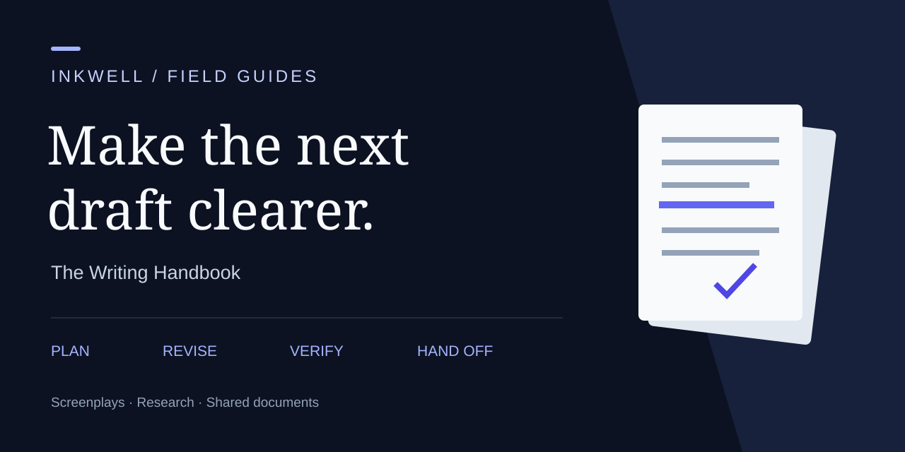

# Inkwell Writing Handbook



**Plan a draft, review a revision, and prepare a clean handoff.** Practical workflows and reusable templates for screenwriters, novelists, researchers, and teams working on structured documents.

Maintained by [Inkwell](https://github.com/inkwell-app). The templates work in any editor; the resource directory connects each job to Inkwell’s products, free tools, guides, and research.

## Start with something useful

| Your next task | Start here | Take away |
|---|---|---|
| Turn an idea into a draft | [Plan a draft](workflows/plan-a-draft.md) | A brief and a scene or section outline |
| Work through feedback | [Review a revision](workflows/review-a-revision.md) | A prioritized revision log and a decision record |
| Review an AI editing suggestion | [Review AI edits](workflows/review-ai-edits.md) | A checklist that preserves intent and checks evidence |
| Send work to another person or tool | [Prepare a handoff](workflows/prepare-a-handoff.md) | A manifest and a round-trip checklist |

## Copy a template

Start with the [template selection and adaptation guide](docs/choose-a-template.md). Pick one useful artifact for your next task; a short solo pass does not need every table.

Download the repository as a ZIP using **Code → Download ZIP**, or clone it:

```sh
git clone https://github.com/inkwell-app/writing-handbook.git
cd writing-handbook
```

No installation or Inkwell account is required to use these Markdown templates.

- [Project brief](templates/project-brief.md) — audience, purpose, constraints and a definition of done.
- [Scene or section outline](templates/outline.md) — what changes in each unit of the draft.
- [Revision log](templates/revision-log.md) — turn feedback into decisions you can verify.
- [Continuity ledger](templates/continuity-ledger.md) — track story facts, claims and dependencies.
- [Feedback session](templates/feedback-session.md) — run a table read, workshop or document review.
- [Handoff manifest](templates/handoff-manifest.md) — name the files, versions and known limitations.
- [Research evidence ledger](templates/evidence-ledger.md) — connect claims to sources and uncertainty.

Practice with [The Last Light](examples/the-last-light.md), a screenplay revision with before-and-after passages, or [a library workshop decision](examples/library-workshop.md), a structured document with evidence limits and conflicting feedback.

## Find the right Inkwell resource

<!-- resources:start -->

### Write with Inkwell

| Resource | Use it for |
|---|---|
| [Inkwell](https://www.inkwell.software/?utm_source=github&utm_medium=referral&utm_campaign=writing_handbook&utm_id=github_writing_handbook&utm_source_platform=github&utm_content=directory_home) | Writing platform overview |
| [Plot](https://www.inkwell.software/plot?utm_source=github&utm_medium=referral&utm_campaign=writing_handbook&utm_id=github_writing_handbook&utm_source_platform=github&utm_content=directory_plot) | Screenwriting and screenplay revision |
| [Canvas](https://www.inkwell.software/canvas?utm_source=github&utm_medium=referral&utm_campaign=writing_handbook&utm_id=github_writing_handbook&utm_source_platform=github&utm_content=directory_canvas) | Structured documents; see the product page for current availability |
| [Features](https://www.inkwell.software/features?utm_source=github&utm_medium=referral&utm_campaign=writing_handbook&utm_id=github_writing_handbook&utm_source_platform=github&utm_content=directory_features) | Explore writing, history, AI and collaboration |
| [Plans and pricing](https://www.inkwell.software/pricing?utm_source=github&utm_medium=referral&utm_campaign=writing_handbook&utm_id=github_writing_handbook&utm_source_platform=github&utm_content=directory_pricing) | Current plans and entitlements |
| [Start writing](https://app.inkwell.software/signup?utm_source=github&utm_medium=referral&utm_campaign=writing_handbook&utm_id=github_writing_handbook&utm_source_platform=github&utm_content=directory_signup) | Create an account |

### Find your workflow

| Resource | Use it for |
|---|---|
| [Screenwriters](https://www.inkwell.software/for/screenwriters?utm_source=github&utm_medium=referral&utm_campaign=writing_handbook&utm_id=github_writing_handbook&utm_source_platform=github&utm_content=directory_screenwriters) | Draft and revise a screenplay |
| [Writers’ rooms](https://www.inkwell.software/for/writers-room?utm_source=github&utm_medium=referral&utm_campaign=writing_handbook&utm_id=github_writing_handbook&utm_source_platform=github&utm_content=directory_writers_room) | Collaborate on scripts |
| [Showrunners](https://www.inkwell.software/for/showrunners?utm_source=github&utm_medium=referral&utm_campaign=writing_handbook&utm_id=github_writing_handbook&utm_source_platform=github&utm_content=directory_showrunners) | Keep a season coherent |
| [Novelists](https://www.inkwell.software/for/novelists?utm_source=github&utm_medium=referral&utm_campaign=writing_handbook&utm_id=github_writing_handbook&utm_source_platform=github&utm_content=directory_novelists) | Organize long-form prose |
| [Researchers](https://www.inkwell.software/for/researchers?utm_source=github&utm_medium=referral&utm_campaign=writing_handbook&utm_id=github_writing_handbook&utm_source_platform=github&utm_content=directory_researchers) | Develop research documents |
| [Teams](https://www.inkwell.software/for/teams?utm_source=github&utm_medium=referral&utm_campaign=writing_handbook&utm_id=github_writing_handbook&utm_source_platform=github&utm_content=directory_teams) | Review shared documents |
| [Students and educators](https://www.inkwell.software/for/education?utm_source=github&utm_medium=referral&utm_campaign=writing_handbook&utm_id=github_writing_handbook&utm_source_platform=github&utm_content=directory_education) | Teach and practice writing |

### Use a free writing tool

| Resource | Use it for |
|---|---|
| [FDX Inspector](https://www.inkwell.software/tools/fdx-inspector?utm_source=github&utm_medium=referral&utm_campaign=writing_handbook&utm_id=github_writing_handbook&utm_source_platform=github&utm_content=directory_fdx_inspector) | Inspect a Final Draft file before a handoff |
| [Fountain validator](https://www.inkwell.software/tools/fountain-validator?utm_source=github&utm_medium=referral&utm_campaign=writing_handbook&utm_id=github_writing_handbook&utm_source_platform=github&utm_content=directory_fountain_validator) | Check screenplay structure |
| [Screenplay Diff](https://www.inkwell.software/tools/screenplay-diff?utm_source=github&utm_medium=referral&utm_campaign=writing_handbook&utm_id=github_writing_handbook&utm_source_platform=github&utm_content=directory_screenplay_diff) | Compare two drafts |
| [Script breakdown](https://www.inkwell.software/tools/script-breakdown?utm_source=github&utm_medium=referral&utm_campaign=writing_handbook&utm_id=github_writing_handbook&utm_source_platform=github&utm_content=directory_script_breakdown) | Prepare a scene inventory |
| [Dialogue balance](https://www.inkwell.software/tools/dialogue-balance?utm_source=github&utm_medium=referral&utm_campaign=writing_handbook&utm_id=github_writing_handbook&utm_source_platform=github&utm_content=directory_dialogue_balance) | Explore who speaks |
| [All tools](https://www.inkwell.software/tools?utm_source=github&utm_medium=referral&utm_campaign=writing_handbook&utm_id=github_writing_handbook&utm_source_platform=github&utm_content=directory_tools) | Browse the complete tool catalog |

### Learn and explore

| Resource | Use it for |
|---|---|
| [Resources](https://www.inkwell.software/resources?utm_source=github&utm_medium=referral&utm_campaign=writing_handbook&utm_id=github_writing_handbook&utm_source_platform=github&utm_content=directory_resources) | Guides and interactive references |
| [Templates](https://www.inkwell.software/templates?utm_source=github&utm_medium=referral&utm_campaign=writing_handbook&utm_id=github_writing_handbook&utm_source_platform=github&utm_content=directory_templates) | Screenplay and TV starting points |
| [Writing and product blog](https://www.inkwell.software/blog?utm_source=github&utm_medium=referral&utm_campaign=writing_handbook&utm_id=github_writing_handbook&utm_source_platform=github&utm_content=directory_blog) | Practical writing and revision articles |
| [Screenwriting glossary](https://www.inkwell.software/glossary?utm_source=github&utm_medium=referral&utm_campaign=writing_handbook&utm_id=github_writing_handbook&utm_source_platform=github&utm_content=directory_glossary) | Look up a term |
| [Interoperability guide](https://www.inkwell.software/resources/interop?utm_source=github&utm_medium=referral&utm_campaign=writing_handbook&utm_id=github_writing_handbook&utm_source_platform=github&utm_content=directory_interop) | Understand Fountain and FDX handoffs |
| [Import an FDX file](https://www.inkwell.software/resources/guides/import-fdx?utm_source=github&utm_medium=referral&utm_campaign=writing_handbook&utm_id=github_writing_handbook&utm_source_platform=github&utm_content=directory_import) | Prepare a Final Draft import |
| [Screenplay Anatomy Atlas](https://www.inkwell.software/resources/screenplay-anatomy?utm_source=github&utm_medium=referral&utm_campaign=writing_handbook&utm_id=github_writing_handbook&utm_source_platform=github&utm_content=directory_anatomy) | Explore screenplay structure |
| [Scene Order Lab](https://www.inkwell.software/resources/scene-order-lab?utm_source=github&utm_medium=referral&utm_campaign=writing_handbook&utm_id=github_writing_handbook&utm_source_platform=github&utm_content=directory_scene_order) | Practice scene continuity |
| [Screenplay dialogue research](https://www.inkwell.software/resources/screenplay-dialogue?utm_source=github&utm_medium=referral&utm_campaign=writing_handbook&utm_id=github_writing_handbook&utm_source_platform=github&utm_content=directory_dialogue) | Explore the measurements and their methods |

### Get help and follow the product

| Resource | Use it for |
|---|---|
| [Help center](https://www.inkwell.software/help?utm_source=github&utm_medium=referral&utm_campaign=writing_handbook&utm_id=github_writing_handbook&utm_source_platform=github&utm_content=directory_help) | Product instructions |
| [Changelog](https://www.inkwell.software/changelog?utm_source=github&utm_medium=referral&utm_campaign=writing_handbook&utm_id=github_writing_handbook&utm_source_platform=github&utm_content=directory_changelog) | Recent product changes |
| [Compare writing tools](https://www.inkwell.software/compare?utm_source=github&utm_medium=referral&utm_campaign=writing_handbook&utm_id=github_writing_handbook&utm_source_platform=github&utm_content=directory_compare) | Evaluate your options |
| [Security](https://www.inkwell.software/security?utm_source=github&utm_medium=referral&utm_campaign=writing_handbook&utm_id=github_writing_handbook&utm_source_platform=github&utm_content=directory_security) | Security information |
| [Contact](https://www.inkwell.software/contact?utm_source=github&utm_medium=referral&utm_campaign=writing_handbook&utm_id=github_writing_handbook&utm_source_platform=github&utm_content=directory_contact) | Reach the Inkwell team |
| [About Inkwell](https://www.inkwell.software/about?utm_source=github&utm_medium=referral&utm_campaign=writing_handbook&utm_id=github_writing_handbook&utm_source_platform=github&utm_content=directory_about) | Learn about the team |

### Read in your language

| Resource | Use it for |
|---|---|
| [Resources — Deutsch](https://www.inkwell.software/de/resources?utm_source=github&utm_medium=referral&utm_campaign=writing_handbook&utm_id=github_writing_handbook&utm_source_platform=github&utm_content=directory_de) | Published localized resource hub |
| [Resources — Español](https://www.inkwell.software/es/resources?utm_source=github&utm_medium=referral&utm_campaign=writing_handbook&utm_id=github_writing_handbook&utm_source_platform=github&utm_content=directory_es) | Published localized resource hub |
| [Resources — Français](https://www.inkwell.software/fr/resources?utm_source=github&utm_medium=referral&utm_campaign=writing_handbook&utm_id=github_writing_handbook&utm_source_platform=github&utm_content=directory_fr) | Published localized resource hub |
| [Resources — 日本語](https://www.inkwell.software/ja/resources?utm_source=github&utm_medium=referral&utm_campaign=writing_handbook&utm_id=github_writing_handbook&utm_source_platform=github&utm_content=directory_ja) | Published localized resource hub |
| [Resources — 한국어](https://www.inkwell.software/ko/resources?utm_source=github&utm_medium=referral&utm_campaign=writing_handbook&utm_id=github_writing_handbook&utm_source_platform=github&utm_content=directory_ko) | Published localized resource hub |

<!-- resources:end -->

## Open tools and research

These are maintained separately. Follow their own licenses and usage instructions.

| Resource | What it provides |
|---|---|
| [screenplay-interop](https://github.com/inkwell-app/screenplay-interop) | Original Fountain and FDX fixtures with expected behavior for tool developers |
| [Fountain Structure](https://huggingface.co/spaces/Inkwell-Software/fountain-structure) | Interactive Fountain structure demo |
| [FDX Anatomy](https://huggingface.co/spaces/Inkwell-Software/fdx-anatomy) | Interactive Final Draft file demo |
| [Revision Colors](https://huggingface.co/spaces/Inkwell-Software/revision-colors) | Revision-color reference demo |
| [Dialogue Word Concentration](https://huggingface.co/datasets/Inkwell-Software/dialogue-word-concentration) | Aggregate dialogue analysis; read the card’s methodology and limitations |
| [Screenplay Format Edge Cases](https://huggingface.co/datasets/Inkwell-Software/screenplay-format-edge-cases) | Original synthetic format examples for evaluation |
| [Screenplay Revision Evaluation](https://huggingface.co/datasets/Inkwell-Software/screenplay-revision-evaluation) | Original synthetic revision tasks; not a model leaderboard |

## Scope and contributions

This handbook covers planning, drafting, revision, evidence and handoff. Product instructions and availability live on Inkwell’s website. File-format conformance belongs in `screenplay-interop`; model and dataset research belongs on Hugging Face.

Suggest a resource, improve a workflow, or contribute an original template through [a pull request](CONTRIBUTING.md). Do not submit private drafts, personal data, or text you do not have permission to share. For product support, use the help and contact links above.

## Attribution and reuse

Original handbook text, templates and tooling are [MIT licensed](LICENSE). External resources retain their own licenses; linking does not relicense them. Inkwell’s name and branding are not granted by the content license. [Cite this handbook](CITATION.cff) using a release tag or commit for reproducibility.

Links to Inkwell may include referral tags. External references retain their original URLs and attribution.
